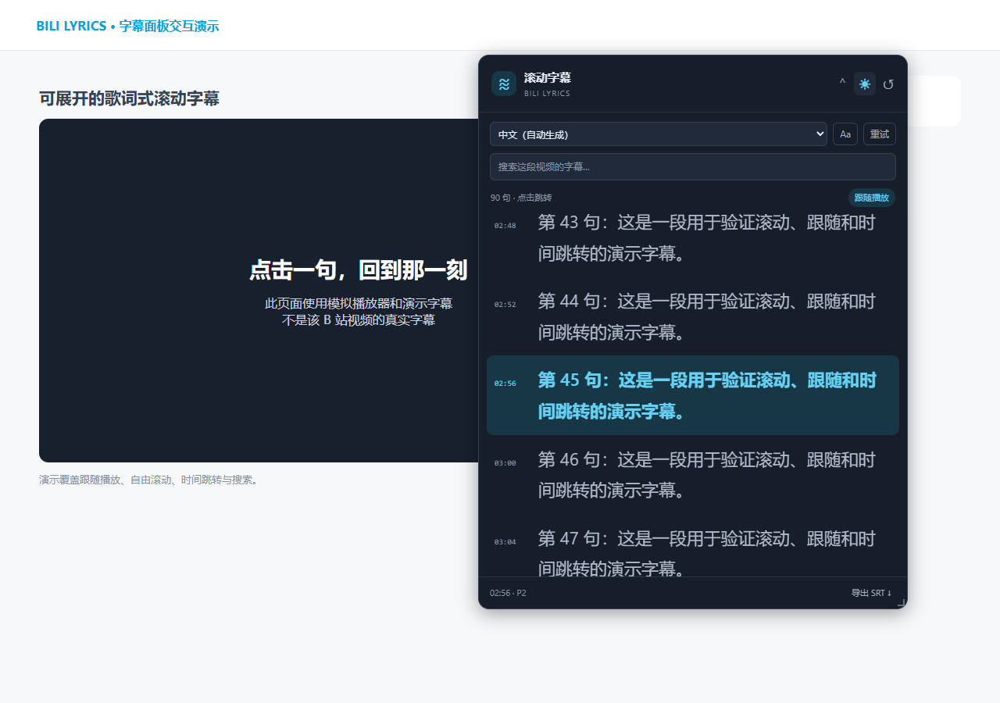
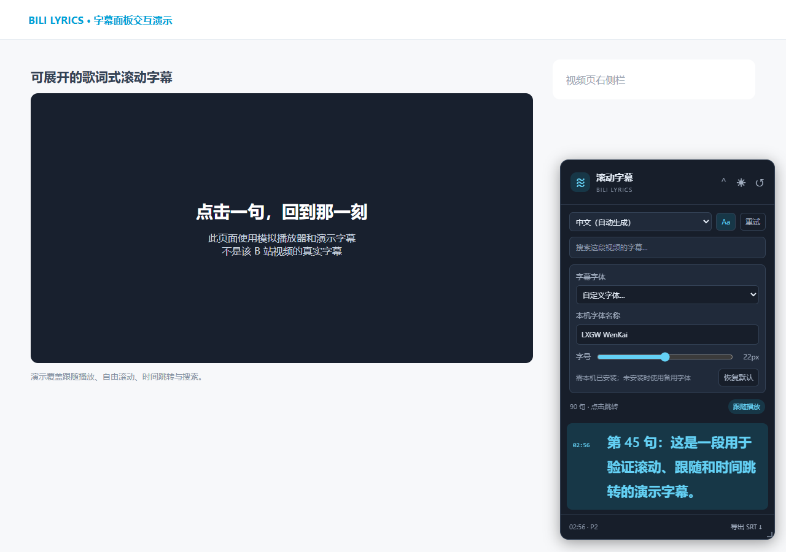

# Bili Lyrics · B站滚动字幕

把 Bilibili 视频字幕变成可以翻阅、点击跳转的歌词面板。安装到篡改猴后，在视频页右下角展开即可使用。

**[安装 / 更新脚本](https://raw.githubusercontent.com/Thank-starlight/bili-lyrics/main/bili-lyrics.user.js)** · **[下载安装包](https://github.com/Thank-starlight/bili-lyrics/releases/latest/download/bili-lyrics-install.zip)** · [反馈问题](https://github.com/Thank-starlight/bili-lyrics/issues)



*截图使用演示字幕。另可查看[浅色模式](docs/images/light.png)。*

## 功能

- 随播放高亮当前句，像歌词一样自动滚动。
- 上下滚动浏览全文；点击任意一句，视频跳转到对应时间并播放。
- 搜索字幕内容、选择字幕语言、切换视频分 P。
- 拖动标题栏移动面板，从边缘和四角调整宽高。
- 一键切换深色 / 浅色模式，自动记住位置、大小和主题。
- 使用顶部的 **Aa** 设置字幕字体，支持常用字体、本机自定义字体名称和 12–32px 字号，刷新后保留。
- 点击标题展开或收起，点击 `↺` 恢复默认位置和大小。
- 导出当前字幕轨道的 SRT 文件，保留毫秒时间戳。

只需要浏览器和 Tampermonkey。日常使用不需要 Python、Node.js、服务器或 API Key。

## 安装

### 1. 安装 Tampermonkey

在**观看 B 站视频的同一个浏览器**中安装 [Tampermonkey（篡改猴）](https://www.tampermonkey.net/)。安装扩展后，还需要安装本项目的脚本。

### 2. 允许扩展运行用户脚本

打开浏览器的扩展管理页面，进入 Tampermonkey 的「详情」，开启 **「允许用户脚本」或「允许运行用户脚本」**。

在 Chrome 138 及更新版本、已验证的豆包浏览器 147 中，**仅打开开发者模式可能仍无法运行脚本**。较旧的 Chromium 浏览器按篡改猴的提示开启开发者模式。具体说明见 [Tampermonkey 官方 FAQ](https://www.tampermonkey.net/faq.php#Q209)。

### 3. 安装 Bili Lyrics

点击 **[安装 / 更新脚本](https://raw.githubusercontent.com/Thank-starlight/bili-lyrics/main/bili-lyrics.user.js)**，在篡改猴打开的确认页选择「安装」或「更新」。

如果只显示一整页代码，或者无法访问 GitHub Raw：

1. [下载备用安装包](https://github.com/Thank-starlight/bili-lyrics/releases/latest/download/bili-lyrics-install.zip)并解压。
2. 打开 `install.html`，点击「复制全部脚本」。Windows 也可以双击 `启动安装页.cmd`。
3. 打开篡改猴管理面板，选择「添加新脚本」。**用复制的代码替换编辑器里的全部内容**，按 `Ctrl+S` 保存。
4. 如果已经安装过旧版，请编辑原来的「B站滚动字幕 · Bili Lyrics」，替换全部代码后保存，避免重复安装。

也可以直接复制仓库中 [bili-lyrics.user.js](bili-lyrics.user.js) 的全部源码，按上面的步骤手动安装。

### 4. 打开视频

登录 Bilibili，打开或刷新一个普通的 [BV 视频页](https://www.bilibili.com/video/BV1XfD7BeEve/)。点击右下角 **「滚动字幕」** 展开面板，首次展开时才会获取字幕。

## 使用方法

| 操作 | 方法 |
| --- | --- |
| 展开 / 收起 | 点击标题栏中的「滚动字幕」 |
| 移动面板 | 按住标题栏拖动；收起时也可以移动 |
| 调整大小 | 展开面板后，拖动边缘或四角 |
| 切换深浅主题 | 点击标题栏的月亮 / 太阳按钮 |
| 设置字幕字体 | 点击顶部 **Aa**，选择常用字体或「自定义字体…」，输入本机已安装的字体名称 |
| 调整字幕字号 | 在 **Aa** 设置中拖动字号滑块，范围为 12–32px |
| 恢复默认字体 | 在 **Aa** 设置中点击「恢复默认」，不会改变面板位置、大小或主题 |
| 恢复默认布局 | 点击标题栏的 `↺`，主题选择会保留 |
| 跳转播放 | 点击任意一句字幕 |
| 自由浏览 | 在字幕列表中上下滚动，自动跟随会暂停 |
| 恢复跟随 | 点击「回到当前句」；搜索词会同时清空 |
| 搜索全文 | 在搜索框输入关键词，再点击匹配的字幕跳转 |
| 切换语言 | 使用面板顶部的语言下拉框 |
| 切换分 P | 使用 B 站原有的选集列表，面板会获取新分 P 的字幕 |
| 重新获取 | 点击「重试」，适用于登录后、字幕刚开启或暂时加载失败时 |
| 导出字幕 | 点击「导出 SRT」，导出完整的当前轨道，不受搜索过滤影响 |

位置、大小、主题和字体设置保存在当前浏览器的 B 站站点存储中，刷新后仍会保留。清除站点数据后会恢复默认设置。浏览器窗口缩小时，面板会自动保持在可见范围内。

### 自定义字幕字体

点击 **Aa → 字幕字体 → 自定义字体…**，输入字体名称，例如 `LXGW WenKai` 或 `霞鹜文楷`。设置会立即应用到字幕正文，时间戳和操作按钮保持原有字体。

字体需要已经安装在本机；下拉列表中的预设也不会自动下载字体。未安装或名称不匹配时，浏览器会使用备用字体。当前版本不导入字体文件，也不请求在线字体。调整面板大小与调整字号是独立的操作。



## 常见问题

### 装好了，但没有看到面板

1. 确认当前浏览器安装了篡改猴，并且脚本列表中有「B站滚动字幕 · Bili Lyrics」。
2. 确认扩展和脚本的开关均为启用状态。
3. 到浏览器的扩展详情页检查「允许运行用户脚本」权限。
4. 刷新视频页，查看网页右下角。面板入口显示在网页中。
5. 脚本目前匹配 `https://www.bilibili.com/video/*`，不适用于直播、番剧页或嵌入式播放器。

### 提示需要登录，或者字幕列表为空

AI 字幕通常需要 B 站登录状态。先登录，再点击面板的「重试」。也可以先在 B 站播放器里开启「字幕」后再重试。

**空列表不一定代表视频没有字幕**：也可能是未登录、字幕尚未生成、接口临时限制或当前分 P 未提供字幕。这个脚本读取已有字幕，不负责生成字幕。

### 有字幕，但无法跳转

先在原播放器中播放一下视频，再点击字幕。如果浏览器阻止自动播放，跳转后手动点击播放器的播放按钮。

脚本通过页面的 `video` / `bwp-video` 元素同步时间。B 站播放器版本变化时，可能需要调整兼容逻辑。

### 手动滚动后不再自动跟随

这是为了方便阅读。点击「回到当前句」，或点击某句字幕跳转，即可恢复跟随播放。

### 怎样更新

再次点击顶部的「安装 / 更新脚本」，在篡改猴中确认更新，然后刷新 B 站视频页。通过该链接安装的版本也带有更新地址；是否自动检查更新取决于篡改猴设置。

### 是否会上传账号或字幕

脚本没有后端服务。API 请求使用浏览器已有的 B 站登录状态，字幕正文直接从 B 站 CDN 获取，不携带账号 Cookie。脚本不把账号或字幕上传到第三方服务器；界面偏好保存在本机站点存储中。

## 工作原理

1. `GET /x/web-interface/view?bvid=...`：获得稿件 `aid` 和各分 P 的 `cid`。
2. `GET /x/web-interface/nav`：获得 WBI 签名密钥。
3. `GET /x/player/wbi/v2?aid=...&bvid=...&cid=...&wts=...&w_rid=...`：通过带签名的播放器接口获取字幕轨道。
4. 下载轨道的 `subtitle_url`，读取 `body[].from`、`to` 和 `content`。时间单位为秒。
5. 监听播放器时间变化，高亮并滚动到当前句；点击字幕时修改播放时间。

这些是 B 站网页播放器内部接口，并非承诺稳定的开放 API。登录要求、风控和返回字段可能变化。

面板挂载在 B 站 Vue 页面根节点之外，避免页面初始化和重绘影响面板。接口会校验返回的 `aid/cid`，异步请求会隔离过期结果，避免切换语言或分 P 时显示上一段字幕。

参考：[播放器接口](https://github.com/bilibili-plugins/bilibili-api-collect/blob/master/docs/video/player.md) · [WBI 签名](https://github.com/bilibili-plugins/bilibili-api-collect/blob/master/docs/misc/sign/wbi.md) · [字幕请求追溯](https://github.com/gcnyin/bilibili-subtitle-api)

## 开发与验证

```sh
npm ci
npx playwright install --with-deps chromium
npm test
```

Windows 测试优先使用本机 Chrome / Edge；没有找到时使用 Playwright 安装的 Chromium。也可通过环境变量 `BILI_TEST_BROWSER` 指定浏览器可执行文件。

- `npm run test:core`：验证 WBI 签名、MD5、时间定位、SRT 格式和字幕地址校验。
- `npm test`：另运行浏览器交互测试，覆盖字幕同步、跳转、搜索、分 P、语言、错误处理、请求竞态、拖动、缩放、主题、自定义字体、字号、持久化和窗口边界。
- `npm run build:installer`：修改脚本后，同步源码到独立安装页 `install.html`。

浏览器自动化测试使用模拟字幕和模拟播放器。曾在豆包浏览器 147 + 篡改猴测试版 5.6.6242 中验证真实视频页，并在登录后成功读取示例视频 P1 的 4868 句字幕及点击跳转；1.1.0 新增的窗口交互由自动化测试验证。

参见 [更新记录](CHANGELOG.md) 和 [贡献说明](CONTRIBUTING.md)。反馈问题时，请提供浏览器版本、篡改猴版本、脚本版本、视频链接和具体错误提示。
